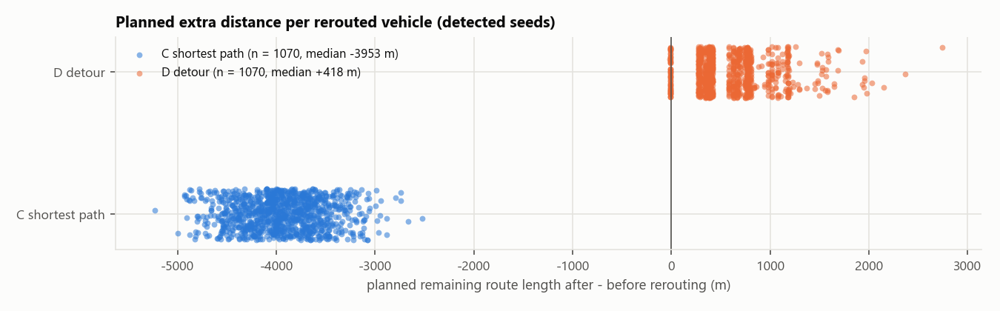
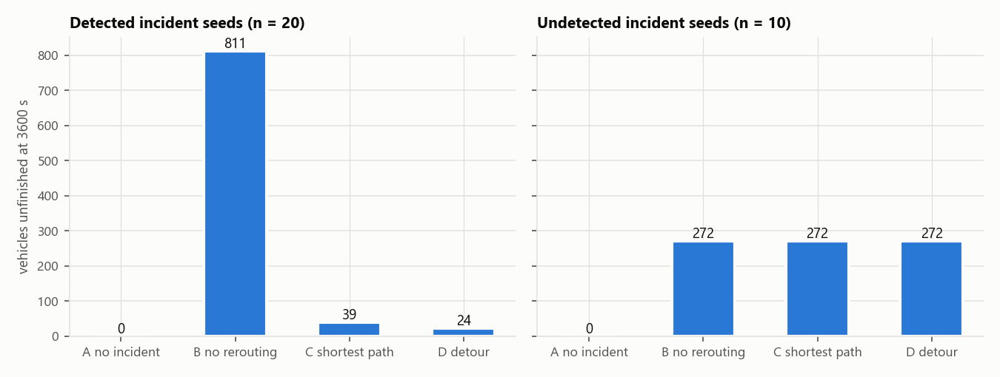
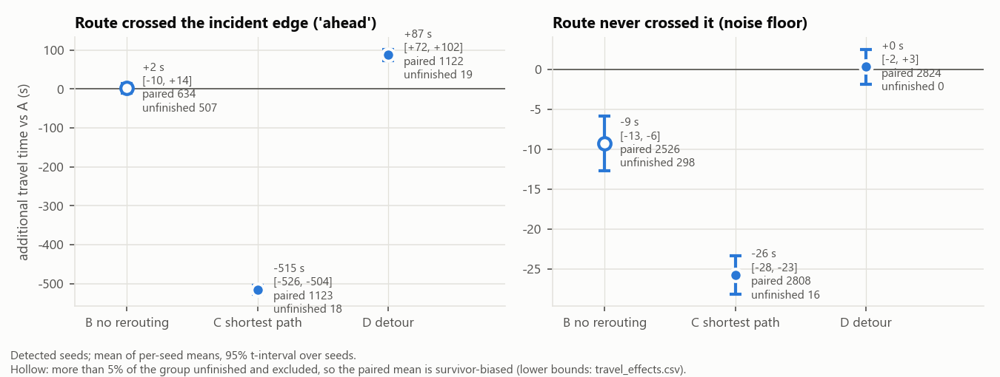

# Block E: route-preserving incident detours and routing comparison

Date: 2026-11-18. Branch `akhil`, uncommitted. SUMO 1.27.1, Python 3.11.4.

**Simulation only:**
- synthetic 5x5 urban grid;
- synthetic random-walk demand;
- a staged stop (TraCI), not a real collision.

All numbers come from `results/incident_routing/`, produced by `python run.py incident-compare -d 200 --runs 30`. That command takes 4 min 19 s on 16 cores. `--analyse-only` re-derives every table and figure from `per_vehicle.csv` without re-simulating.

## 1. Summary

**Method.** Informed vehicles now bypass the incident edge and rejoin their own planned route after it (`detour`, the new default). Previously they replaced the whole remaining route with a shortest path to the destination. That earlier method stays available as `--method shortest`, the comparison baseline.

Results on the 20 seeds where the stop is detected (200 vehicles each):

| | Shortest path (C) | Detour (D) |
|---|---|---|
| Eligible vehicles rerouted | 1070 / 1141 (93.8 %) | 1070 / 1141 (93.8 %), the same 71 not rerouted |
| Entries onto the incident edge after rerouting | 0 | 0 |
| Original route kept up to the edge before the incident edge | 4 / 49 in d200_r02 | 866 / 1070 (the other 204 split one edge earlier, see section 2); all 1070 keep the route up to their split edge and from their rejoin edge, checked from the record |
| Planned extra distance per rerouted vehicle, median | −3953 m (the trip is cut short) | +418 m (about one block around) |
| Measured extra travel time vs no incident, `ahead` group | −515 s [−526, −504] (shorter trip; not a gain) | **+87 s [72, 102]** |
| Measured extra distance vs no incident, `ahead` group | −4109 m | **+606 m [538, 674]** |
| Vehicles unfinished at 3600 s (stopped vehicle excluded) | 39 | 24 |

- **Main result:** the detour keeps each trip's origin, its route up to the split edge (the edge before the incident edge, or one edge earlier at a corner), the route after the rejoin edge, and the destination. In this grid it costs an affected vehicle about 87 s and 606 m on average. The shortest-path method's "time saving" comes from discarding most of the planned trip, so it is not a routing benefit.
- **Without rerouting (B) the grid locks up:** 811 of 3980 vehicles are unfinished at 3600 s (20 detected seeds) and 272 of 1990 (10 undetected seeds). With either rerouting method only 39 (C) or 24 (D) are unfinished. This happens under the chosen settings: teleporting disabled and the incident left in place until 3600 s (section 6).
- **Do not claim** that the detour reduces jams compared with shortest-path. The 39-versus-24 difference comes from one seed (r27: 19 versus 0). That jam is a deadlock on edge B2C2, away from the incident edge D2D1, from t ≈ 381 s. Without r27, D has 24 unfinished and C has 20. D has more unfinished vehicles than C in three seeds (r10, r15, r20), and C more than D only in r27.

## 2. The detour algorithm (`incident_response.detour`)

`R` is the remaining route: `R[0]` is the current edge, or, for a vehicle inside a junction, the edge before it. For each future occurrence of the incident edge E, in route order:

1. **Split edge `s`:** try from the latest (the longest kept prefix) down to the previous rejoin point or the current edge. Inside a junction the next edge is fixed, so the earliest split is `R[1]`.
2. **Rejoin edge `j`:** try from the earliest after E (the longest kept suffix).
3. **Path:**
   - From a split ahead of the vehicle: `simulation.findRoute(R[s], R[j])`. It sees E as blocked through a global travel-time weight, which is set only in detour responses to a genuine accepted alert.
   - From the vehicle's own edge (`s = 0`): the vehicle's own router (`changeTarget`), so SUMO's rule applies. A vehicle too close to the junction keeps its next edge, so it is never sent into a last-second turn.
4. **Splice:** `R[:s] + path + R[j+1:]`. Each kept edge carries its index in `R`; positions are never found by looking up an edge's value.
5. **Install and check:** `setRoute`, only after `verify` passes. It checks:
   - same current edge;
   - same destination;
   - no future E;
   - no edge repeated back to back;
   - kept edges unchanged and in order;
   - prefix up to the first split and suffix from the last rejoin intact.
   SUMO must then report the same route and `isRouteValid`. If SUMO refuses or installs something else, the original route is restored and the vehicle is reported.

**Recorded per attempt:**
- original and final route;
- every splice: split edge and index, rejoin edge and index, detour edges, replaced edges;
- number of probes;
- failure reason;
- planned lengths;
- wall-clock compute time (kept outside the deterministic record).

`incident_response.preserved()` rebuilds every final route from the original route and the recorded splices. This holds for all 1070 detours in the 30-seed incident record: `detours_rebuilt_from_record`.

**Safety conditions, checked before relying on them** (scratchpad probes on the d200 seeds):
- **Probes are reversible.** A rejected `changeTarget` probe is undone with `setRoute(original)` plus removal of the vehicle's adapted travel time. After undoing probes on 57 vehicles (d200_r03), every TraCI-visible field (route including passed edges, route index, via, road, lane, position, speed, validity) was identical. The next 300 s of traffic were identical, vehicle by vehicle, to a run without probes. The code checks the restoration after every probe and stops if it fails.
- **Junctions.** For a vehicle inside a junction, a route that changes only edges after its next edge is accepted (`isRouteValid`), and the vehicle drives on normally. Changing the next edge itself is never attempted: the vehicle is reported as committed.
- **Committed vehicles are not forced.** In the d200 seeds, forcing a `findRoute` route onto vehicles SUMO considers committed (v163 in r10, v177 in r03) left each in a lane that did not continue on the new route, and each braked to 2–4 m/s at the junction. The detour therefore reports such vehicles as having no alternative.

**Edge cases seen in the 30 seeds** (from `sessions/*.json`, session D):
- **E more than once in a route:** 157 vehicles; every occurrence bypassed, up to 4 splices per vehicle.
- **Rerouted while inside a junction:** 67 vehicles, all split at `R[1]` or later.
- **Split one edge earlier:** 204 vehicles, all in the four seeds whose incident edge leaves a grid corner (r10 A0B0, r15 E4E3, r20 E0E1, r26 A0A1).
  - The edge before E ends at the corner, and E is its only exit, so the split backs off by exactly one edge.
  - Every rejoin is the edge right after E.
- **"Shorter" detours of −8 m or −16 m:** 58 vehicles in the same four seeds. The detour takes the other two sides of the corner block: the same number of edges, with interior edges 4 m shorter (189.2 m against 193.2 m).
- **No detour possible (71, the same vehicles as under shortest-path):**
  - destination is the incident edge: 58;
  - inside the junction onto it: 5;
  - no split or rejoin works (too close to the junction to turn, or a corner whose only exit is the incident edge): 8.

## 3. Experiment design

| Session | Incident | Response |
|---|---|---|
| A | none | none |
| B | staged stop at the scenario's incident second, kept until 3600 s | detection and alert as usual; nobody rerouted |
| C | same | shortest-path reroute of the vehicles that accepted the verified alert |
| D | same | route-preserving detour of the same vehicles |

- **Same inputs everywhere:**
  - seeds d200 r00–r29 (seed rule 10000 + 100·density + run);
  - the same routes file and SUMO seed;
  - the same options (`--step-length 1 --collision.action none --time-to-teleport -1`, which are the SUMO-GUI demo's options);
  - every session ends at 3600 s.
- **Trip data:** SUMO's tripinfo, including unfinished vehicles (`--tripinfo-output.write-unfinished`; these have `arrival = -1`).
- **Distance check:** `routeLength` was checked against the odometer (`vehicle.getDistance`) for all 1070 detoured vehicles that finished. They agree within 15.8 m, which is less than one 1 s step of driving, so `routeLength` is the distance driven even after a route replacement.
- **Groups**, fixed at the response instant from the stopped vehicle's actual edge (read-only, identical in B, C and D; checked):
  - `ahead`: the incident edge is still in the route;
  - `upstream`: already on it, behind the stop;
  - `not_crossing`: neither, the noise-floor group.
- **Detected and undetected seeds.** In the 10 undetected seeds no alert is released, so C and D are exactly B in every seed (checked: `C_equals_B`, `D_equals_B` in `completion.csv`). They show the incident's cost without a response.
- **Pairing:** each vehicle is compared with itself in another session (same ID, same demand).
  - Paired differences use vehicles that finished in both sessions.
  - A vehicle finished in the reference session but unfinished in the compared one is censored. Its difference is at least (3600 − depart) − its reference duration, which gives a **lower bound** on the group mean that counts every unfinished vehicle.
- **Confidence intervals:** per seed, the mean of the per-vehicle paired differences; then the mean over seeds with a two-sided 95 % Student-t interval (df = seeds − 1). The seed is the unit, because vehicles in one seed are not independent.
- **Noise floor:** SUMO's vehicles share random-number streams, so any change anywhere also changes unaffected trips. The `not_crossing` group shows how large that effect is.

## 4. Results

### 4.1 Rerouting (detected seeds; `rerouting.csv`)

| | Shortest path (C) | Detour (D) |
|---|---|---|
| Eligible (`ahead`, accepted the verified alert) | 1141 | 1141 |
| Rerouted / success rate | 1070 / 93.8 % | 1070 / 93.8 % |
| Unable (reported, route left unchanged under D) | 71 | 71 (58 destination, 5 inside junction, 8 no split/rejoin) |
| Entries onto the incident edge after rerouting (until 3600 s) | 0 | 0 |
| Planned extra distance: median (min, max) | −3953 m (−5229, −2525) | +418 m (−16, +2745) |
| Compute time per vehicle: median / p95 / max | 0.97 / 1.28 / 4.87 ms | 1.40 / 6.31 / 29.84 ms |

Compute times are wall clock including TraCI round trips, measured with 16 sessions running in parallel; they depend on the machine. The detour's upper tail comes from vehicles that needed many probes (up to 50).

### 4.2 Unfinished vehicles at 3600 s (`completion.csv`; the stopped vehicle excluded)

| Seeds | Vehicles | A | B | C | D |
|---|---|---|---|---|---|
| Detected (20) | 3980 | 0 | 811 | 39 | 24 |
| Undetected (10) | 1990 | 0 | 272 | 272 | 272 |

**Per detected seed, unfinished in B / C / D:**

| Seed | B / C / D | Seed | B / C / D | Seed | B / C / D | Seed | B / C / D |
|---|---|---|---|---|---|---|---|
| r02 | 109 / 1 / 1 | r08 | 0 / 0 / 0 | r16 | 100 / 1 / 1 | r23 | 39 / 1 / 1 |
| r03 | 136 / 2 / 2 | r10 | 14 / 1 / 2 | r18 | 20 / 0 / 0 | r25 | 0 / 0 / 0 |
| r04 | 14 / 1 / 1 | r12 | 0 / 0 / 0 | r19 | 23 / 0 / 0 | r26 | 18 / 1 / 1 |
| r05 | 66 / 0 / 0 | r13 | 22 / 1 / 1 | r20 | 34 / 5 / 6 | r27 | 37 / 19 / 0 |
| r06 | 100 / 2 / 2 | r15 | 9 / 1 / 3 | r21 | 36 / 2 / 2 | r29 | 34 / 1 / 1 |

**Per undetected seed, unfinished in B (= C = D):**

| Seed | B | Seed | B | Seed | B | Seed | B | Seed | B |
|---|---|---|---|---|---|---|---|---|---|
| r00 | 21 | r07 | 20 | r11 | 20 | r17 | 47 | r24 | 62 |
| r01 | 55 | r09 | 17 | r14 | 17 | r22 | 12 | r28 | 1 |

- **Why B locks up** (inspected in d200_r02):
  1. The vehicles behind the stopped car in its lane need that lane for their next turn, and SUMO's lane-change model does not take them past it.
  2. The queue spills back into the junction.
  3. With teleporting disabled the jam spreads. In d200_r02, 110 vehicles were stuck from about 1000 s to 3600 s.
- **Under C and D**, the remaining unfinished vehicles are mostly the ones directly behind the stopped car (`upstream`) plus single-seed jams such as r27 under C.

### 4.3 Paired travel-time and distance effects (`travel_effects.csv`)

Detected seeds. Means are the mean of per-seed means with a 95 % t-interval. "LB" is the lower bound on the mean counting unfinished vehicles.

| Comparison | Group | Vehicles | Unfinished (compared) | Paired | Δ time (s) [95 % CI] | Δ distance (m) [95 % CI] | LB Δ time (s) |
|---|---|---|---|---|---|---|---|
| B − A | ahead | 1141 | 507 | 634 | +2.0 [−10.1, +14.0] | +1.0 [+0.2, +1.7] | **+1263.8** |
| B − A | not_crossing | 2824 | 298 | 2526 | −9.3 [−12.7, −5.9] | −0.1 [−0.2, −0.0] | +292.5 |
| C − A | ahead | 1141 | 18 | 1123 | −515.0 [−526.4, −503.6] | −4109.2 [−4204.4, −4013.9] | −462.8 |
| C − A | not_crossing | 2824 | 16 | 2808 | −25.8 [−28.1, −23.4] | −0.1 [−0.2, −0.0] | −9.5 |
| D − A | ahead | 1141 | 19 | 1122 | **+87.0 [+72.1, +101.9]** | **+606.1 [+537.8, +674.4]** | +133.8 |
| D − A | not_crossing | 2824 | 0 | 2824 | +0.3 [−1.9, +2.5] | −0.1 [−0.2, +0.0] | +0.3 |
| D − C | ahead | 1141 | 19 | 1119 | +601.8 [+582.1, +621.5] | +4715.3 [+4576.8, +4853.8] | +613.5 |
| D − C | not_crossing | 2824 | 0 | 2808 | +26.2 [+23.5, +28.9] | +0.1 [−0.1, +0.2] | +26.1 |

The `upstream` group (15 vehicles in 8 seeds) has CIs spanning roughly ±50 s for every comparison and is listed in the CSV.

Undetected seeds, B − A, `ahead`: 239 of 576 unfinished, LB +1170.6 s. C and D are identical to B there.

Reading these numbers:

- **B's paired means are survivor-biased.** About 44 % of the `ahead` group is excluded because it never finishes. The incident's cost without rerouting is at least +1264 s per `ahead` vehicle on average, the lower bound, not the +2 s paired mean.
- **D − A is the detour's cost.** The trip is the same apart from the bypass. Per vehicle the median is +88 s (5th–95th percentile −18 to +244 s).
- **C − A and C − A on `not_crossing` are confounded.** C shortens rerouted trips by about 4.1 km. Those vehicles then leave the network early, so everybody else meets less traffic (−26 s). That reflects changed demand, not better routing. For the same reason, D − C (+602 s) is not a measure of D being worse.
- **Noise floor.** Unaffected vehicles under D move +0.3 s [−1.9, +2.5] on average, but a single unaffected trip moves by −90 to +90 s (5th–95th percentile) between sessions. Only group means with CIs are interpretable. A per-vehicle difference of less than about 90 s cannot be attributed to the routing method.

## 5. What can and cannot be claimed

| Can be claimed (this simulator, these settings) | Cannot be claimed |
|---|---|
| The detour keeps each rerouted vehicle's prefix, rejoin suffix and destination, rebuilt from the record, and never re-enters the incident edge. | Any real-world travel time or distance. |
| Both methods reroute the same 93.8 % of eligible vehicles; the same 71 cannot be rerouted, and each is reported with its reason. | That shortest-path rerouting saves time (−515 s is a shortened trip). |
| The detour costs about +87 s and +606 m per affected vehicle in this grid, against a noise floor of ±2.5 s for group means. | That the detour reduces jams compared with shortest-path (one seed decides the 39-versus-24 difference). |
| With teleporting disabled and the incident kept until 3600 s, rerouting either way avoids most of the gridlock that occurs without rerouting. | That gridlock of this size would occur in real traffic or with other SUMO settings. |

## 6. Limitations

1. **Synthetic setting.** Grid and demand are synthetic, at one density (200) and one network. Routes are random walks, so the "original plan" is not a driver's preferred route.
2. **Gridlock in B depends on the settings.** Teleporting is disabled (the demo's setting), the incident is never cleared, and SUMO's lane-change model does not let vehicles that need the blocked lane pass the stopped car. B's numbers are an extreme of these settings, not a typical incident cost.
3. **The global weight.** The detour gives E a global travel-time weight so `findRoute` can start from a future edge. No vehicle acts on global weights in this project (there is no rerouting device), so only vehicles given a new route with `setRoute` change behaviour. A study that enables SUMO's rerouting device would need a per-vehicle mechanism instead.
4. **Measurement details.**
   - Planned lengths count edge lengths only, not junction-internal lanes.
   - Compute times are wall clock on this machine with 16 parallel sessions.
   - Groups are fixed at the response instant. Spillback can still delay `not_crossing` vehicles; this is part of what the noise floor shows.
5. **Unchanged from the earlier milestone:**
   - staged stop, not a collision;
   - detection only for stops from ≥ 9.5 m/s (10 of 30 seeds undetected);
   - dissemination computed on the snapshot one step before detection;
   - the certificate check counts any ≥ 3 reputable signers (CLAUDE.md).

## 7. Tests

`validation/test_incident_routing.py` has 11 tests and runs in about 54 s together with the incident tests:

- **Fake-network tests** (a fake TraCI on a 2×4 ladder network that routes like SUMO), covering:
  - bypass with the prefix, destination and downstream rejoin kept;
  - two occurrences of E with repeated edge values, checked by exact route index;
  - split back-off at a corner whose only exit is E;
  - a committed vehicle, where every rejected probe is undone;
  - inside a junction, where the next edge never changes;
  - a refused route or a blocked destination, which leaves the vehicle unchanged;
  - only a vehicle that accepted the alert is detoured, and no global weight is set otherwise.
- **Live SUMO tests:**
  - detours on d200_r02 keep each route and change nothing else, while the forged alert changes nothing;
  - the shortest-path baseline still works and differs as expected;
  - the four sessions are paired, reproducible (two runs give identical rows apart from timings) and write only to their own folder;
  - the CI and censoring arithmetic.

The 10 incident-response tests from the last milestone are unchanged and now run with the detour default.

**Full regression** after the portal rebuild:
- `python -m pytest validation -q`: 135 passed (114 original + 10 incident + 11 routing).
- `python -m pytest veremi -q`: 26 passed.

`results/urban` unchanged.

## 8. Files

| File | Change |
|---|---|
| `incident_response.py` | `detour`, `_probe`, `verify`, `preserved`, `remaining`, `planned_m`. `respond`, `Response`, `session` and `run` take `method`. Route records, `route_changes`, the global weight for detours only, ground-truth groups, odometer, scenario A (`stop=False`), `dissemination()`. Two new acceptance checks. |
| `incident_routing.py` (new) | Four sessions per seed, tripinfo parsing, paired effects with CIs and lower bounds, rerouting table, completion table, three figures. |
| `config.py` | `REROUTE_METHOD = "detour"`, `ROUTING_EVAL_END_S = 3600`. |
| `run.py` | `incident --method {detour,shortest}`; `incident-compare [-d] [--runs] [--end] [--analyse-only]`. |
| `validation/test_incident_routing.py` (new) | 11 tests. |
| `portal/downloads/*` | Rebuilt bundle. |

**Outputs:** `results/incident_routing/`, untracked:
- `per_vehicle.csv` (6000 rows);
- `travel_effects.csv`;
- `rerouting.csv`;
- `completion.csv`;
- `experiment_config.json`;
- `figures/`;
- `tripinfo/`, `sessions/`, `raw/`, `logs/`;
- `gui/`: the SUMO-GUI check with the detour default (49 rerouted, 0 entries).
